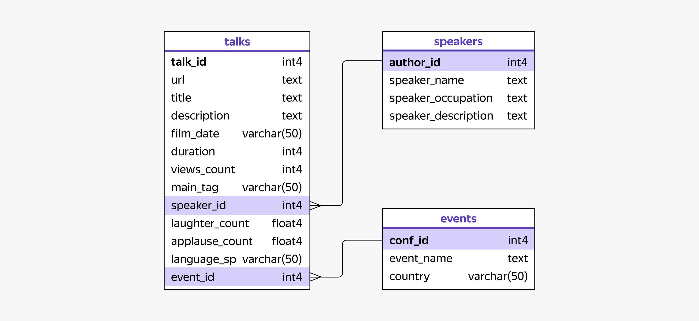

# Project3light_TEDtalks

## 📖 Контекст данных
Данный проект представляет собой разработку интерактивного дашборда на основе данных о конференциях TED. 

**Бизнес-цель:** В аналитическое агентство обратилась компания, которая приобрела лицензию на проведение конференций TED. Им предстоит организовать первое мероприятие, и для этого нужно изучить опыт прошлых лет: какие темы популярны, кто из спикеров собирает больше всего зрителей, какова средняя длительность выступлений и как правильно спланировать тайминг.

Дашборд создан для того, чтобы помочь заказчику принять решения по подбору площадки, выбору формата и составлению программы мероприятия.

## 📊 Основные возможности дашборда
Разработанный дашборд решает следующие аналитические задачи:
*   **Верхнеуровневые метрики:** общее количество конференций, общее количество выступлений, уникальное число спикеров и тем.
*   **Анализ конференций:** детализация от стран к конкретным мероприятиям. Пользователь может посмотреть среднюю длительность выступлений, максимальное количество просмотров, количество аплодисментов за конференцию и число выступающих.
*   **Анализ выступлений:** топ-10 самых смешных выступлений (по количеству смеха) и топ-20 самых популярных тегов выступлений.
*   **Анализ выступающих:** выявление родов деятельности спикеров, которым больше всего аплодируют.
*   **Детализация:** возможность посмотреть подробную информацию о каждом выступлении (название, страна, дата записи, кол-во просмотров, тема, название выступления (кликнув на название выступления осуществляется переход к видеозаписи выступления - url-ссылка, спикер).
*   **Интерактивность:** на дашборде реализованы селекторы по стране, названию конференции, тегу выступления и дате записи.

## 🗄️ Структура данных
Данные представлены тремя таблицами: `events` (конференции), `speakers` (выступающие) и `talks` (выступления).

*(Схема связей таблиц talks, speakers и events)*

### Таблица `events` (Конференции)
| Столбец | Тип | Описание |
| :--- | :--- | :--- |
| `conf_id` | INT (PK) | Идентификатор конференции |
| `event_name` | TEXT | Название конференции |
| `country` | VARCHAR | Страна проведения |

### Таблица `speakers` (Выступающие)
| Столбец | Тип | Описание |
| :--- | :--- | :--- |
| `author_id` | INT (PK) | Идентификатор выступающего |
| `speaker_name` | TEXT | Имя выступающего |
| `speaker_occupation` | TEXT | Род деятельности |
| `speaker_description` | TEXT | Краткое описание |

### Таблица `talks` (Выступления)
| Столбец | Тип | Описание |
| :--- | :--- | :--- |
| `talk_id` | INT (PK) | Идентификатор выступления |
| `url` | TEXT | Ссылка на видео |
| `title` | TEXT | Название выступления |
| `description` | TEXT | Описание выступления |
| `film_date` | VARCHAR | Дата записи |
| `duration` | INT | Длительность (в секундах) |
| `views_count` | INT | Количество просмотров |
| `main_tag` | VARCHAR | Основной тег |
| `speaker_id` | INT (FK) | Ссылка на `author_id` в `speakers` |
| `laughter_count` | FLOAT | Количество смеха в зале |
| `applause_count` | FLOAT | Количество аплодисментов |
| `language_sp` | VARCHAR | Язык выступления |
| `event_id` | INT (FK) | Ссылка на `conf_id` в `events` |

## 🛠️ Инструменты и структура проекта
Для разработки дашборда использовалась BI-система **DataLens** (Яндекс). 

*   `DataLens_Dashboard`: Ссылка на опубликованный дашборд и скриншоты его работы;
*   `README.md`: Описание проекта и структуры данных;
*   `dataset_schema.png`: ER-диаграмма связей таблиц (приложена в README.md).

## 📁 Запуск проекта
1. Откройте ссылку на дашборд в DataLens https://datalens.yandex/aluqpqkvegvit?_share_link=public ;
2. Воспользуйтесь ER-диаграммой связи таблиц для понимания структуры данных.
